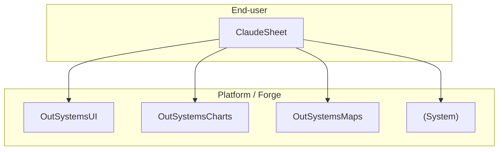

# Architecture

Last reviewed: 2026-10-14

## Modules

| Module | App | Type | Layer | Version |
|---|---|---|---|---|
| ClaudeSheet | ClaudeSheet | Reactive | End-user | 0 |

## Layers

This project follows the OutSystems Architecture Canvas. References only go **down** or **sideways within Foundation**. End-user modules never reference each other, and Core never references End-user.

| Layer | Holds | Typical suffixes |
|---|---|---|
| End-user | Screens and UI flows for one user group | (none), `_UI`, `_Portal` |
| Core | Entities, business rules and services shared across apps | `_CS`, `_BL` |
| Foundation | Reusable non-business pieces: integrations, themes, patterns | `_IS`, `_Th`, `_Pat`, `_Lib` |

## External references

Platform modules used by ClaudeSheet, taken from the dependencies in `snapshots/ClaudeSheet/data-model.cs` and `structures.cs`. `listApps` didn't load any of them as references.

| Module | Used for |
|---|---|
| OutSystemsUI | Theme, UI patterns, static entities and structures |
| OutSystemsCharts | Chart blocks and structures |
| OutSystemsMaps | Map blocks and structures |
| (System) | User, Group, Role, Tenant and other system entities; Login/Logout |

There are no Core or Foundation modules yet.

## Integrations

TODO: external systems (REST, SOAP, SAP, databases), the module that owns each one, and where its credentials are configured. Never put the credentials here.

## Open questions

- TODO
