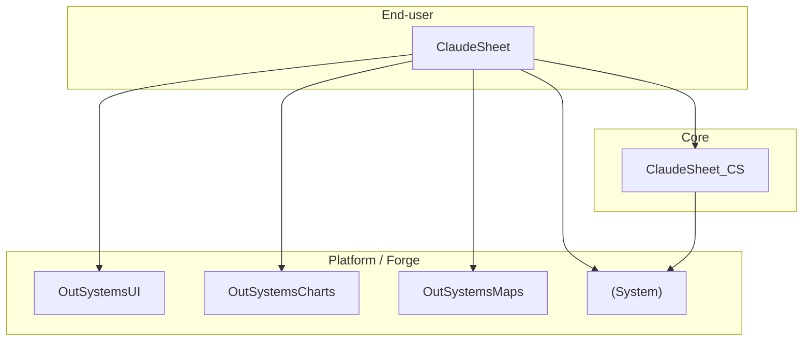

# Architecture

Last reviewed: 2026-10-15 (split into End-user + Core, [ADR 0004](decisions/0004-split-end-user-and-core.md))

## Modules

| Module | App | Type | Layer | Version | Role |
|---|---|---|---|---|---|
| ClaudeSheet_CS | ClaudeSheet | Reactive | Core | 0 | Backend: database, timers, processes, server actions, structures |
| ClaudeSheet | ClaudeSheet | Reactive | End-user | 0 | Front end: screens, blocks, data actions, screen and client actions, theme |

Status: the split is done (TT4, published 2026-10-15). ClaudeSheet_CS holds the backend, and ClaudeSheet keeps only front-end elements plus the login template (`DoLogin`, `DoLogout`).

## What goes where

| Element | Module | Notes |
|---|---|---|
| Entities and static entities (database) | ClaudeSheet_CS | Public, **Read Only = Yes**. Writes go through public CS server actions. |
| Timers | ClaudeSheet_CS | With the server action they run (e.g. `Bootstrap`). |
| Processes (BPT) | ClaudeSheet_CS | None yet. |
| Server actions | ClaudeSheet_CS | Public when ClaudeSheet calls them; each starts with the role check. |
| Structures | ClaudeSheet_CS | Public when ClaudeSheet uses them, including the structures that only feed blocks. |
| Roles | ClaudeSheet_CS | `SheetUser` is checked by the CS server actions, so it lives there (public); screens in ClaudeSheet reference it. |
| User exceptions | ClaudeSheet_CS | Raised by CS server actions (e.g. `DaySheetValidation`), public so ClaudeSheet can catch them. |
| Site properties | ClaudeSheet_CS | Read by CS server actions. Site properties can't be shared across modules: ClaudeSheet reads them through a public CS server action (e.g. `Settings_GetDailyExpectedMinutes`). |
| Screens, blocks, UI flows | ClaudeSheet | |
| Data actions, screen and block actions | ClaudeSheet | Data actions call CS server actions. |
| Client actions | ClaudeSheet | Run in the browser; e.g. `Minutes_Format`, `Date_GetWeekStart` (their server versions live in CS). |
| Theme, CSS, images, scripts | ClaudeSheet | |
| Client variables | ClaudeSheet | |
| Login template (`DoLogin`, `DoLogout`, Common flow) | ClaudeSheet | OutSystems template login flow, kept with the screens that use it. |

## Layers

This project follows the OutSystems Architecture Canvas. References only go **down** or **sideways within Foundation**. End-user modules never reference each other, and Core never references End-user.

| Layer | Holds | Typical suffixes |
|---|---|---|
| End-user | Screens and UI flows for one user group | (none), `_UI`, `_Portal` |
| Core | Entities, business rules and services shared across apps | `_CS`, `_BL` |
| Foundation | Reusable non-business pieces: integrations, themes, patterns | `_IS`, `_Th`, `_Pat`, `_Lib` |

ClaudeSheet_CS must never reference ClaudeSheet.

## Working across modules

- **Producer first.** ClaudeSheet only sees what ClaudeSheet_CS has **published**. A story that touches both is a pipeline: CS change → review → publish CS → add new dependencies in ClaudeSheet → refresh references → ClaudeSheet change → review → publish ClaudeSheet.
- **Refreshing references can be automated, adding them can't.** `omlRefreshReferences` refreshes the existing references of ClaudeSheet to the latest published CS. A new CS element (a new public action, entity or structure) has to be ticked once by hand in Service Studio › Manage Dependencies: the Model API can't add a dependency.
- **Public contract.** Renaming or removing a public CS element breaks ClaudeSheet. Do it in the same story as the consumer change, and publish CS and ClaudeSheet together.
- **One subagent per module** for multi-module stories; see `CLAUDE.md` › Multi-module stories.

## External references

| Module | Used by | For |
|---|---|---|
| OutSystemsUI | ClaudeSheet | Theme, UI patterns (e.g. `ScrollableArea`), static entities and structures |
| OutSystemsCharts | ClaudeSheet | Chart blocks and structures |
| OutSystemsMaps | ClaudeSheet | Map blocks and structures |
| (System) | both | User, Group, Role, Tenant and other system entities; Login/Logout; `ListAppend` and other system actions |
| ClaudeSheet_CS | ClaudeSheet | The 9 public server actions, the 12 structures and CalendarDayType, DayStatus and Project (with the entities they depend on); see `snapshots/ClaudeSheet_CS/` |

## Integrations

TODO: external systems (REST, SOAP, SAP, databases), the module that owns each one, and where its credentials are configured. Never put the credentials here.

## Open questions

- Should the UI-only structures (`NumberOption`, `DayEditorLine`, `DayStatusKPI`) stay in ClaudeSheet instead? The rule today is "all structures in CS".
